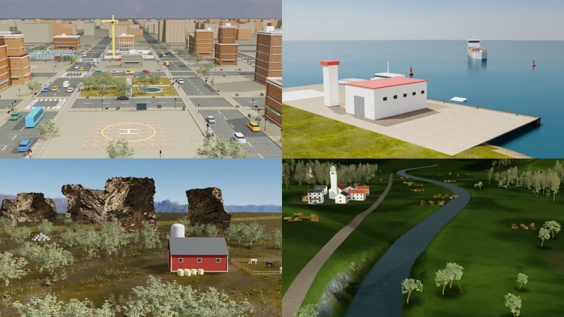

# X500 VLN Benchmark

A vision-and-language navigation (VLN) benchmark for a Holybro X500 V2 quadcopter. A real PX4 autopilot flies it
inside NVIDIA Isaac Sim, in four procedurally varied outdoor environments: **City, Coastal, Forest and Mountain**.

An agent gets a natural-language instruction and the onboard camera stream, flies the drone with stick commands, and
says **STOP** when it thinks it has finished. A fixed, written success rule scores the flight. It works for *any*
flight, not only the expert's.

```
"Fly to the mountain hut with the flag and stop about 50 m from it, facing it."
```



*Onboard camera frames from published simulations. Top: City, Coastal. Bottom: Forest, Mountain.*

## Repository layout

```
x500-vln-benchmark/
├── benchmark/            Benchmark episodes: build, fly, render, publish, score (evaluate.py), checker self-test
├── environments/         Scene generators, missions and the flight/render pipeline the episodes are built with
│   ├── common/           Shared pipeline: X500 vehicle, PX4 SITL flight, stick pilot, slice renderer, Slurm job
│   ├── City/             Procedural city (CC0 Poly Haven assets), 100 Easy missions
│   ├── Coastal/          Procedural coastline, harbour and ships, 100 Easy missions
│   ├── Forest/           River valley with farms and props, 104 Easy missions
│   └── Mountain/         Alpine landscapes (lakes, huts, passes, cable cars), 100 Easy missions
├── examples/
│   └── mountain_episode_001/   One complete published benchmark episode (all files except the video)
└── docs/
    ├── benchmark_format.md     Episode files, success rule, metrics
    ├── dataset_requirements.md Requirements applied to every generated batch
    ├── libraries.md            Simulator stack, versions and links
    └── paths.md                Cluster-specific paths to adapt before running
```

## Dataset vs. benchmark

The environments produce two things:

| | Dataset (training data) | Benchmark episode (evaluation) |
|---|---|---|
| Content | full expert flight: take-off → task → landing | **the task only**: starts in the air, ends at STOP |
| Instruction | one long multi-step instruction | one task + 3 paraphrases + a short version |
| Answer (target, plan) | inside `meta.json` | hidden in `goal.json`, read only by the evaluator |
| Success | not defined | written rule with tolerances, scored by `benchmark/evaluate.py` |
| Files | `trajectory.mp4`, `action.json`, `telemetry.json`, `meta.json` | `task.json`, `goal.json`, `reference/`, `results/` |

See [`docs/benchmark_format.md`](docs/benchmark_format.md) for the full episode format.

## Success rule (inspect task)

An episode succeeds if the agent says STOP within the time limit and, at that moment:

1. its horizontal distance to the target is `D ± max(10, 0.3·D)` m;
2. the target is inside the image, at least 10 % of the frame away from every edge;
3. during the whole episode it never tilted beyond 60° (crash) and never came below 2 m above the ground.

The route, speed, height and hover time are free.

**Metrics** (as in CityNav, AerialVLN and OpenFly): **SR** (success rate), **OSR** (oracle success), **NE**
(navigation error, m) and **SPL** (success weighted by path length). Heading error and target-in-frame fraction are
also reported.

## Quick start: score a flight

The evaluator needs only Python 3 and NumPy. It doesn't need Isaac Sim.

```bash
pip install -r benchmark/requirements.txt

# score the expert flight of the example episode
python benchmark/evaluate.py examples/mountain_episode_001 \
    --telemetry examples/mountain_episode_001/reference/telemetry.json \
    --actions   examples/mountain_episode_001/reference/action.json

# checker self-test: the expert flight plus 8 deliberately wrong edits
python benchmark/selftest.py examples/mountain_episode_001
```

To score an agent, record its flight in the same format as `reference/telemetry.json` and `reference/action.json`,
ending the action list with `{"stop": true}`.

## Generating environments and episodes

Generating new episodes needs the full simulation stack: Isaac Sim 5.1, Pegasus Simulator 5.1.0, PX4 v1.14.3 SITL
and an NVIDIA GPU, plus a Slurm cluster for the batch drivers. See [`docs/libraries.md`](docs/libraries.md),
[`environments/README.md`](environments/README.md) and [`benchmark/README.md`](benchmark/README.md).

> **Note:** the scripts were written for one specific cluster and contain absolute paths (data root, conda install,
> asset cache). They are listed in [`docs/paths.md`](docs/paths.md) and must be adapted before running elsewhere.

## Not included in this repository

| Item | Why | How to get it |
|---|---|---|
| Rendered videos, flights, published datasets | too large for git | generated by the pipeline |
| PX4 build and Python environments (`px4_env/`, `px4_build_env/`) | 3.5 GB of built binaries | `environments/common/scripts/build_px4.sbatch` |
| X500 vehicle USD (`assets/x500/x500.usd`) | generated binary | `environments/common/pipeline/build_x500_usd.py` |
| Poly Haven textures and models | third-party CC0 downloads | `environments/*/scene/fetch_*_assets.py` |
| Run logs, previews, superseded experiments | working files | — |

## License

No license has been chosen yet. Add a `LICENSE` file before publishing. Third-party assets (Poly Haven, CC0) and
software (PX4: BSD-3; Pegasus: BSD-3; Isaac Sim: NVIDIA license) keep their own licenses.
