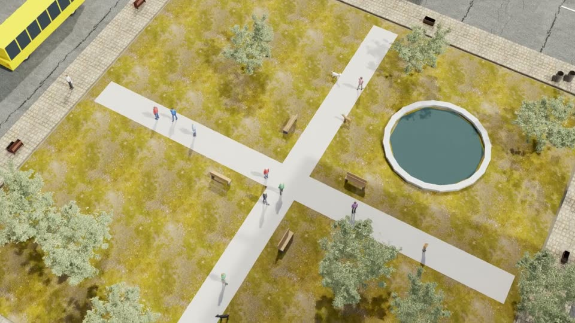
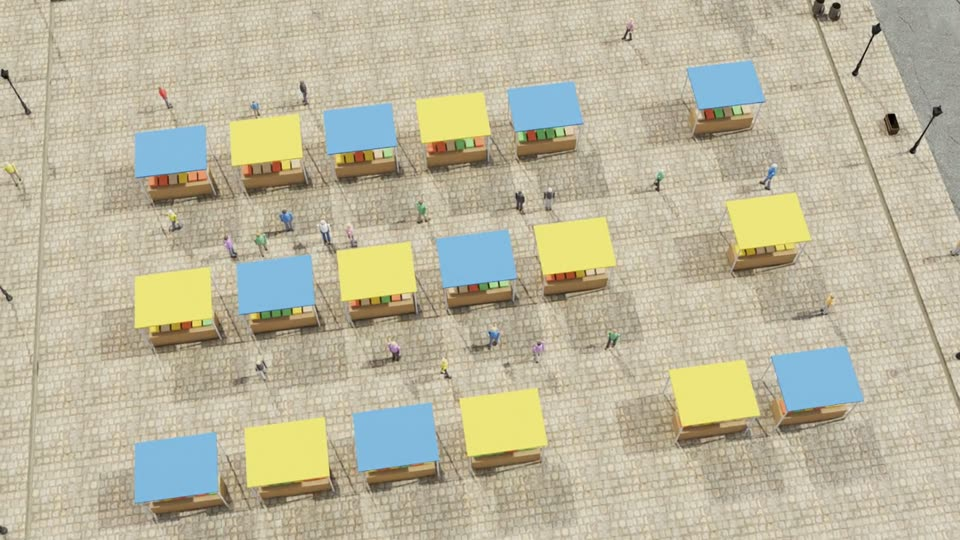
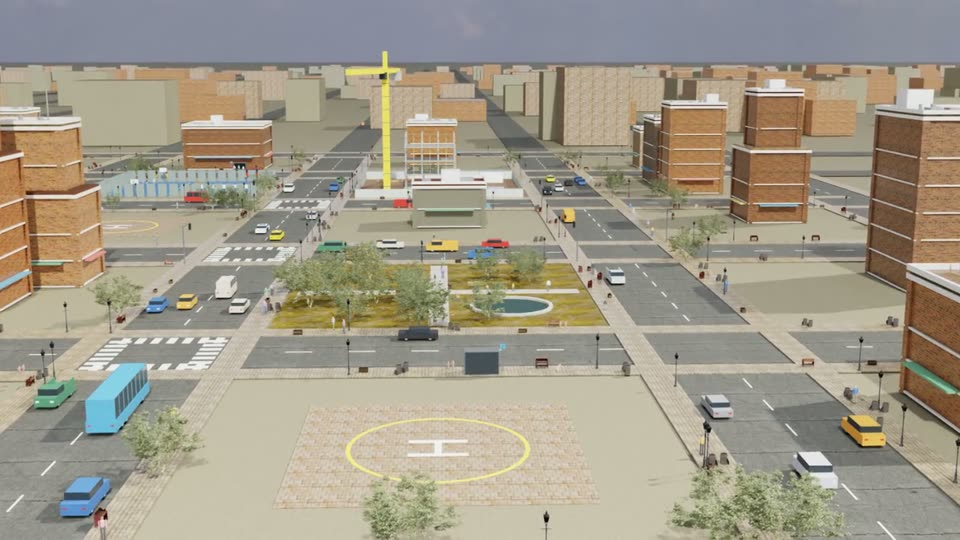

# City

A procedurally generated city built from CC0 Poly Haven assets. Isaac Sim's own library has no city buildings, so the
city is authored. Every simulation of the Easy batch has its own city: block layout, special blocks (parks, plazas,
construction sites), facades, vehicles and people.

**Easy batch:** 100 single-task missions: circle, inspect, pass over, follow road.

| | | |
|---|---|---|
|  |  |  |
| Park block with a fountain (Simulation 23) | Market square (Simulation 41) | City blocks and plaza with helipad (Simulation 88) |

*Frames from the drone's onboard camera in published simulations.*

| File | Role |
|---|---|
| `missions.py` | The 100 Easy City missions (one city per index, `scene/city_v2.plan`). |
| `scene/city_v2.py` | Easy City generator: a different city per simulation. |
| `scene/city_scene.py` | Base authored city (roads, buildings, materials). |
| `scene/city_props.py`, `scene/props.py` | People, vehicles, cones, street furniture and special blocks. |
| `scene/city_bridge.py`, `scene/hq_bridge.py` | Isaac Sim + RealTimePathTracing set-up for the city. |
| `scene/fetch_city_assets.py` | Downloads the CC0 asset set (md5-verified). |
| `scene/run_city_mission.py`, `scene/flight_controller.py` | Earlier single-sortie runner (Simulation_0_0_5) and its controller. |
| `scene/probe_*.py` | Quick visual probes (assets, view, materials) used during development. |
| `scene/make_track_controller.py` | Review video: camera view + trajectory + sticks. |
| `scripts/manage_easy_city.sh` | Batch driver: flight → render slices → publish. |
| `tools_check.py` | Offline check of all missions: plan, physics, clearance, offline flight. |
| `tools_overlap.py` | Offline overlap check of movable props against each other and static parts. |
| `small_copy.sh` | Compressed (< 30 MB) copy of a video for sharing. |
