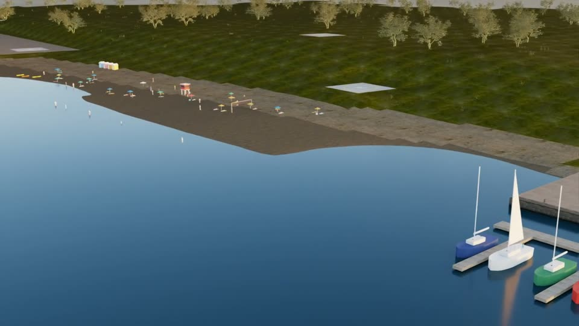
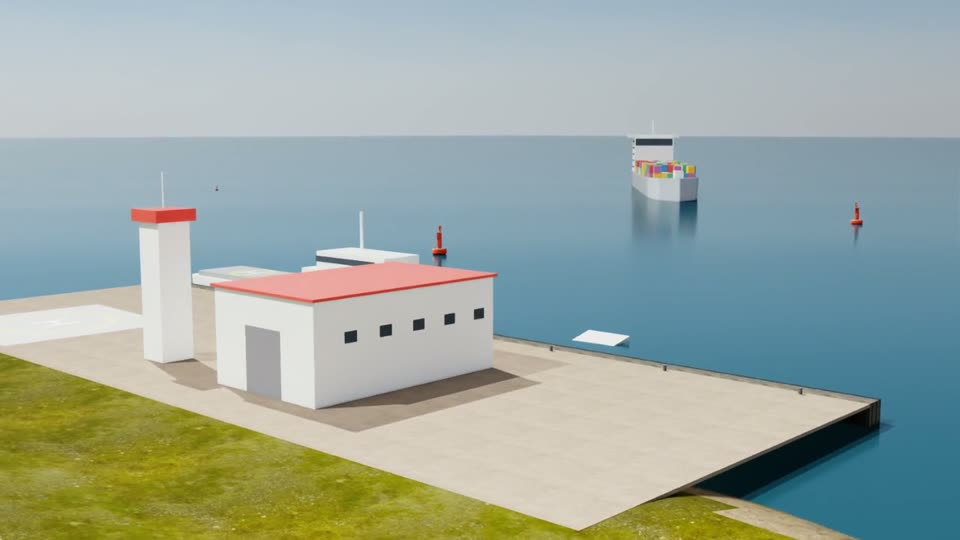
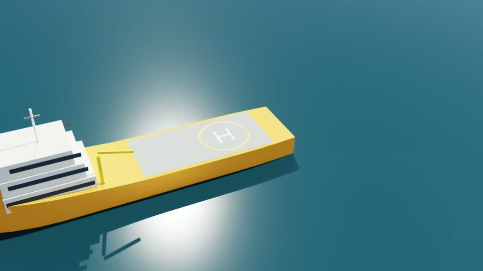

# Coastal

An authored coastline with real elevation: a chain of headlands, beaches, a harbour with ships and docks, a
lighthouse, and coastal people (fishermen, dock workers, swimmers, tourists). Every simulation of the Easy batch has its
own coast.

**Easy batch:** 100 single-task missions: circle, inspect, pass over, follow shore, land on ship.

| | | |
|---|---|---|
|  |  |  |
| Beach and marina (Simulation 41) | Harbour pier, ship offshore (Simulation 66) | Ship landing deck (Simulation 7) |

*Frames from the drone's onboard camera in published simulations.*

| File | Role |
|---|---|
| `missions.py` | The 100 Easy Coastal missions (one coast per index, `scene/coastal_v2.plan`). |
| `scene/coastal_v2.py` | Easy Coastal generator: a different coast per simulation. |
| `scene/coastal_scene.py` | Base authored coastline (Simulation_0_0_7). |
| `scene/coastal_props.py`, `scene/props.py`, `scene/city_props.py` | Coastal, harbour and shared props. |
| `scene/coastal_bridge_v2.py` | Isaac Sim bridge for v2, which also captures depth and segmentation in render jobs. |
| `scene/coastal_bridge.py`, `scene/hq_bridge.py` | Base Isaac Sim + RealTimePathTracing set-up. |
| `scene/fetch_coastal_assets.py`, `scene/fetch_coastal_v2_assets.py` | Download the CC0 asset sets. |
| `scene/run_coastal_mission.py`, `scene/flight_controller.py` | Earlier single-sortie runner and its controller. |
| `scene/probe_*.py` | Visual probes (trajectory frames, water artefact). |
| `scripts/manage_easy_coastal.sh` | Batch driver: flight → render slices → publish. |
| `enrich.py` | Annotations added to every sample at publish time (called by `finalize.py`). |
| `paraphrases_src_*.py`, `paraphrases_v21_*.py` | LLM-written paraphrases (3 + a short version per mission). |
| `build_paraphrases.py` | Merges and checks the paraphrases → `paraphrases_easy.json`. |
| `has_paraphrases.py` | Publish gate: are there paraphrases for the current instruction? |
| `tools/physics_probe.py`, `tools/probe_aux.py` | Physics-only scene check; depth and segmentation annotator probe. |
| `tools_check.py` | Offline check of all missions. |
