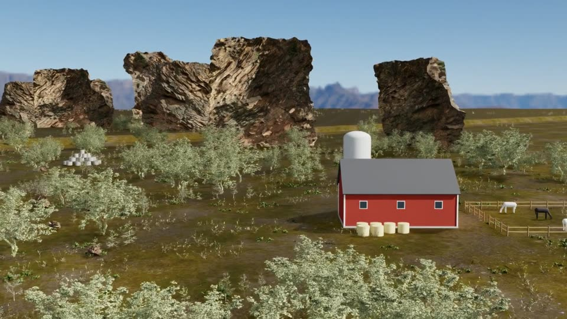
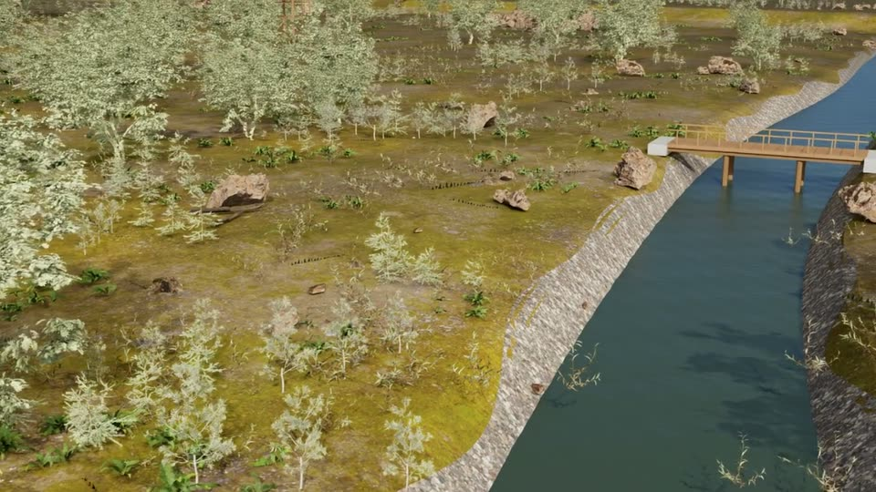
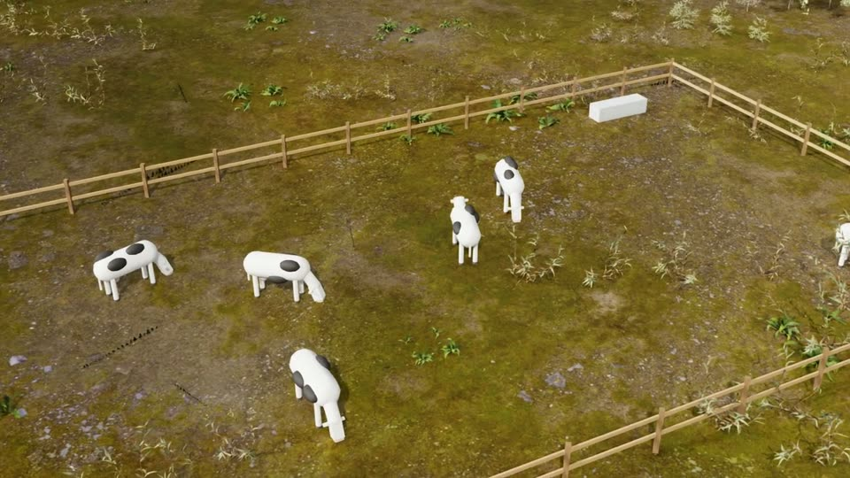

# Forest

A river valley built on the `natural_valley` scene (`common/vln_simulation/natural_valley.py`), with Poly Haven
textures. It has a smoothed terrain, a river channel with a waterfall and a timber footbridge, valley-wall cliffs, and
farm props (farmhouses, barns, silos, paddocks, vehicles). Every simulation of the Easy v2 batch has its own props
layout.

**Easy batch:** 104 single-task missions: circle, inspect, pass over, follow river.

| | | |
|---|---|---|
|  |  |  |
| Barn and valley cliffs (Simulation 41) | River and footbridge (Simulation 66) | Pasture (Simulation 23) |

*Frames from the drone's onboard camera in published simulations.*

| File | Role |
|---|---|
| `missions.py` | Forest missions and landing pads (`apply_pads`). |
| `easy_v2.py` | Easy v2 generator: own props layout per simulation, layout + mission per index. |
| `scene/forest_scene.py` | Customisations on top of `natural_valley`: smooth terrain, river v2, pads. |
| `scene/forest_bridge.py`, `scene/hq_bridge.py` | Isaac Sim + RealTimePathTracing set-up for the valley. |
| `scene/props.py` | Farm and countryside props, physically sound (colliders, mass). |
| `scene/obstacles.json` | Tall static obstacles (cliffs, cliff gate) for offline clearance checks. |
| `scene/run_forest_mission.py`, `scene/flight_controller.py` | Earlier single-sortie runner (Simulations_0_0_4) and its controller. |
| `scene/make_track_controller.py` | Review video: camera view + trajectory + sticks. |
| `scripts/manage_easy_v2.sh` | Batch driver for Easy v2: flight → render slices → publish. |
| `scripts/manage_missions.sh`, `scripts/run_mission.sbatch` | Earlier batch driver and job script. |
| `offline_check.py` | Flies every mission offline (PX4-like model) and prints its stats. |
| `tools/` | Offline checks: grounding of props, layouts, obstacles, stage check (usd-core, no Isaac Sim). |

`scene/obstacle_points.npy` (3.6 MB, generated) is not in the repository.
