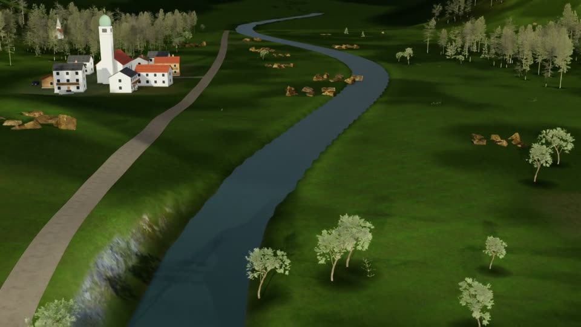
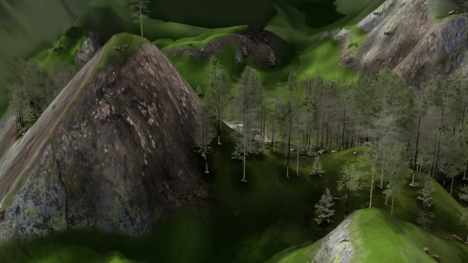
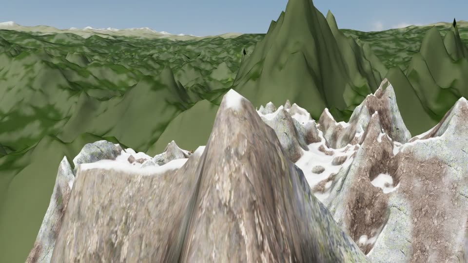

# Mountain

Alpine landscapes: a banded terrain mesh with baked textures, distant ranges, glacial lakes, rivers and roads, conifer
forest belts up to the tree line, snow, and sites such as mountain huts, chapels, farms, boathouses, summit crosses,
passes and cable cars. Every simulation of the Easy batch has its own landscape, season and sky.

**Easy batch:** 100 single-task missions: circle, inspect, pass over, land at, cross lake, cross pass, follow
ridge, follow valley, follow cable car.

| | | |
|---|---|---|
|  |  |  |
| Valley village and river (Simulation 41) | Rock peak and forest belt (Simulation 66) | Ridges above the tree line (Simulation 88) |

*Frames from the drone's onboard camera in published simulations.*

The benchmark episodes in [`../../benchmark`](../../benchmark) are currently built in this environment.

| File | Role |
|---|---|
| `missions.py` | The 100 Easy Mountain missions: `mission_and_plan(idx)`, offline planning with retries. |
| `scene/mountain_v2.py` | Easy Mountain generator: landscape plan per simulation. |
| `scene/mountain_build.py` | USD build inside Isaac Sim: lighting, terrain, ranges, water, roads, sites, vegetation, props. |
| `scene/mountain_sites.py` | Site placement, levelled zones and site contents. |
| `scene/mountain_nature.py` | Vegetation and rocks. |
| `scene/mountain_props.py`, `scene/props.py`, `scene/coastal_props.py`, `scene/city_props.py` | Alpine and shared props. |
| `scene/mountain_bake.py` | Terrain texture bake (realistic rock, grass and snow blending). |
| `scene/mountain_bridge_v2.py` | Isaac Sim bridge for v2, which also captures segmentation in render jobs. |
| `scene/mountain_bridge.py`, `scene/mountain_scene.py`, `scene/hq_bridge.py` | Base authored mountain (Simulation_0_0_6) and renderer set-up. |
| `scene/fetch_mountain_assets.py`, `scene/fetch_mountain_v2_assets.py` | Download the CC0 asset sets. |
| `scene/run_mountain_mission.py`, `scene/flight_controller.py` | Earlier single-sortie runner and its controller. |
| `scene/probe_*.py` | Visual probes (chain view, trajectory frames). |
| `scripts/manage_easy_mountain.sh` | Batch driver: flight → render slices → publish, across partitions. |
| `scripts/render_worker.sbatch`, `scripts/worker_keeper.sh` | Long-lived render workers that hold a GPU until all slices are rendered. |
| `enrich.py` | Per-sample annotations at publish time (task visibility, instruction alignment, landmarks). |
| `paraphrases_src_*.py`, `stamp_canonical.py`, `build_paraphrases.py`, `has_paraphrases.py` | LLM-written paraphrases, their source-instruction stamps, merge/check, publish gate. |
| `tools/offline_all.py`, `tools/offline_check.py` | Plan and fly every mission offline. |
| `tools/physics_audit.py` | Placement audit: nothing floating, buried, in water or overlapping. |
| `tools/verify_pub.py` | Checks of one published simulation. |
| `tools/fix_pass_point.py` | Recomputes the pass-landmark visibility of published runs. |
| `tools/*.sbatch` | CPU job wrappers for the audits and offline checks. |
