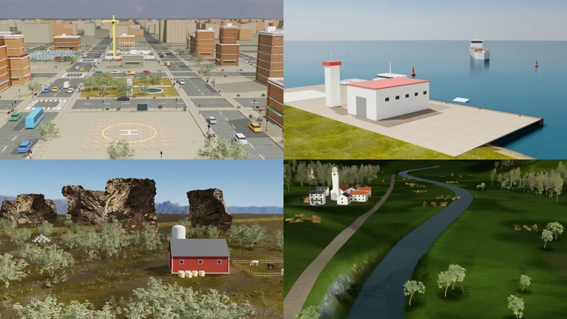

# Environments

Scene generators, mission definitions and the shared flight/render pipeline. Every dataset simulation and every
benchmark episode is produced by this code.



```
environments/
├── common/      shared pipeline (vehicle, PX4 flight, pilot, renderer, publisher, Slurm job)
├── City/
├── Coastal/
├── Forest/
└── Mountain/
```

Each environment has the same structure:

| Path | Role |
|---|---|
| `missions.py` | Mission definitions for the Easy batch: target, task type, beats, instruction. `mission_and_plan(idx)` builds one. |
| `scene/` | Scene builders that run inside Isaac Sim: terrain, buildings, vegetation, props, landmarks, plus the environment's `*_bridge*.py` (Isaac Sim app + renderer set-up). |
| `scene/fetch_*_assets.py` | Downloads the CC0 Poly Haven textures and models the scene uses (md5-verified). |
| `scripts/manage_easy_*.sh` | Batch driver on the Slurm login node: flight → parallel render slices → finalize/publish, with retries. |
| `tools/`, `tools_*.py`, `offline_check.py` | Offline checks without Isaac Sim: planning, terrain clearance, prop placement, physics audits. |
| `enrich.py`, `build_paraphrases.py`, `paraphrases_*` | Per-sample annotations and LLM-written instruction paraphrases (Coastal, Mountain). |

## How one simulation is produced

```
missions.py ──► common/pipeline/run_x500_mission.py   FLIGHT   PX4 SITL + Isaac Sim physics, no rendering
                        │                                       → telemetry.json, action.json, camera poses
                        ▼
               common/pipeline/render_slice.py        RENDER   N slices in parallel, one GPU each,
                        │                                       from the recorded camera poses
                        ▼
               common/pipeline/finalize.py            PUBLISH  stitch trajectory.mp4, verify, write meta.json
```

`common/pipeline/envs.py` boots any of the four environments (`boot("Mountain", kit_dir, mission_id)`), so the flight
job and every render job build exactly the same scene. Rendering slices from recorded poses depends on this.

Run a batch from the login node:

```bash
nohup bash environments/Mountain/scripts/manage_easy_mountain.sh > manager.log 2>&1 &
```

## Environments

| Environment | Easy batch | Scene | Task types |
|---|---|---|---|
| [City](City/README.md) | 100 | procedural city blocks, parks, traffic, people | circle, inspect, pass over, follow road |
| [Coastal](Coastal/README.md) | 100 | headlands, beaches, harbour, lighthouse, ships | circle, inspect, pass over, follow shore, land on ship |
| [Forest](Forest/README.md) | 104 | river valley, cliffs, farms, footbridge | circle, inspect, pass over, follow river |
| [Mountain](Mountain/README.md) | 100 | alpine valleys, lakes, huts, chapels, passes, cable cars | circle, inspect, pass over, land at, cross lake/pass, follow ridge/valley/cable car |

Each simulation in a batch has its own variant of the environment (layout, landscape, season, sky), so no two scenes
are identical.

## Requirements

Isaac Sim 5.1, Pegasus Simulator 5.1.0, PX4 v1.14.3 SITL, an NVIDIA RTX-class GPU, ffmpeg, and Slurm for the batch
drivers. See [`../docs/libraries.md`](../docs/libraries.md). Absolute paths to adapt are listed in
[`../docs/paths.md`](../docs/paths.md).
